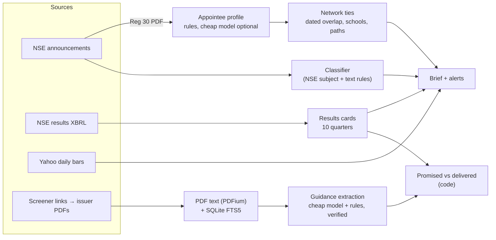

# FINN

A mobile-first desk for an Indian-equity investor. It answers three questions through the day:

- **Push — what changed, and does it matter?** Portfolio filings ranked by materiality, with the numbers or people behind them.
- **Pull — did management deliver what they promised?** Call-transcript guidance checked against results filed with the exchange.
- **Network — who can I call about it?** People in the investor's own network who worked with, studied with or sit one introduction away from the people in the news.

**Demo:** https://finn-demo-ojov.onrender.com (works on a phone; filings, results and prices are real; the network is fictional).

## Try it in 90 seconds

1. **Brief → 7 days.** Tata Power's appointment of its CEO-designate opens with his career *read from the filing's own Regulation 30 profile* (Tata Power Renewable Energy, Tata Power-DDL, NTPC, Reliance Energy since 1996). Underneath: two contacts whose dated careers overlap his, with the introduction path and link strength. Its Q2 FY27 results card shows Revenue, EBITDA, PBT and PAT, QoQ and YoY, computed from the company's XBRL filing.
2. **Brief → Dates → 1 Oct–12 Nov.** HDFC Bank's new MD & CEO, Anup Bagchi: "ICICI Group since 1992", IIM Bangalore, IIT Kanpur. FINN notices that a close contact (Asha Das) was at ICICI Bank 2009–2016, that another sits one introduction away, and that you went to the same schools.
3. **Research → INFY.** FY26 revenue guidance was raised three times (0–3% → 2–3% → 3–3.5%, constant currency); FY27's was lowered twice (1.5–3.5% → 1.5–3% → 1–2%). The 20–22% operating-margin band was delivered in FY26 (20.9% on filed figures) and is on track in FY27.
4. **Research → LTTS.** "Mid-16% EBIT margin by Q4 FY27", repeated on call after call; the filed Q2 FY27 margin is already 16.3%. The FY25 "near 16%" promise came in at 14.9% on filed figures.
5. **People.** Ask "specialty chemicals", or open POLYCAB: contacts at competitors and suppliers come with the reason they are relevant and how strong the link is.

Triggered alerts (price move, ≥2× volume, chosen filing types) sit under the brief; open a private workspace to change thresholds and keep history.

## How it works



| Step | Method | Model? |
| --- | --- | --- |
| Filing triage | NSE's own subject plus the filing text, mapped to the reference taxonomy (results, M&A, management change, litigation, pledging, insider trading…); CEO/MD/CFO changes outrank board changes | No |
| Results card | Exchange XBRL tags; EBITDA = PBT − exceptional + finance costs + D&A − other income; lenders show net interest income instead | No |
| Who is the new executive | Name, role and "Brief profile" from the Regulation 30 PDF; employers, years and schools pulled from that text | Optional cheap pass; every string must occur in the filing |
| Who knows them | Contacts' dated employment vs the person's employers (overlap = strong, same employer = likely, same school = weak); ≤2-hop paths ranked by their weakest link | No |
| Guidance | Keyword-prefiltered transcript passages → strict-schema extraction → exact-quote and literal-number checks; cached per document revision | Cheap model (bulk), rules fallback |
| Promised vs delivered | Metric/period/basis matched to XBRL actuals; above/within/below, "tracking" while the year is open, refused across bases (constant currency vs INR) | No |
| Evidence search | SQLite FTS5 (BM25) over indexed pages | No |
| Optional synthesis | Bounded public passages to one stronger model call, citations verified, cached | Opt-in |

Model routing: high-volume extraction uses `FINN_*_BULK_MODEL` (falls back to the main model); the optional synthesis uses the main model. Only public filing and transcript text is ever sent to a model, never holdings, contacts or notes.

## Data and freshness

- **Shipped snapshot.** `finn/data/snapshot.json` holds 50 days of real NSE filings, Yahoo daily bars, XBRL results and extracted appointments and guidance. It is loaded at start-up, so the free host never shows an empty feed; windows count back from the snapshot time until a live refresh succeeds. Rebuild it from a machine that can reach NSE: `python -m finn.snapshot build --days 50`.
- **Live refresh.** Locally a scheduler fetches filings every 15 minutes and enriches new results and appointments. NSE rejects many cloud IP ranges, which is why the hosted demo relies on the snapshot.
- **Documents.** Up to two annual reports and eight call transcripts per ticker, hashed and re-used by revision; any NSE ticker works.

## Privacy and security (summary)

Each browser gets a signed, expiring (24 h) workspace; holdings, contacts, notes, alerts and reviewed facts are owner-scoped and erasable; mutations need CSRF and same-origin checks. The public demo accepts fictional profiles only; real local imports require recorded consent, purpose and provenance. Full detail, including what a production deployment would add, is in [ARCHITECTURE.md](docs/ARCHITECTURE.md).

## Run it

```bash
cp .env.example .env
docker compose up --build --wait        # http://localhost:8090
docker compose exec -T app python -m unittest discover -s tests
```

Or with Python 3.12: `pip install -r requirements.txt && python -m uvicorn finn.app:app --port 8090`. Model features are off until `FINN_ENABLE_LLM=1` and a key are set; everything above except the optional synthesis works without one. Deployment notes: [DEPLOYMENT.md](docs/DEPLOYMENT.md).

## Deliberately left out, and next

- **Out:** OCR for scanned PDFs, a security master (ISIN/BSE-only names), production identity and backups, live push notifications.
- **Next:** web push or Telegram for alerts; a nightly snapshot job on an Indian-IP runner; segment-level guidance (e.g. constant-currency revenue from the results press release) so IT-services revenue promises can be scored; a stronger reasoning pass for narrative-vs-numbers and bull/bear, grounded in the verified statements above.
