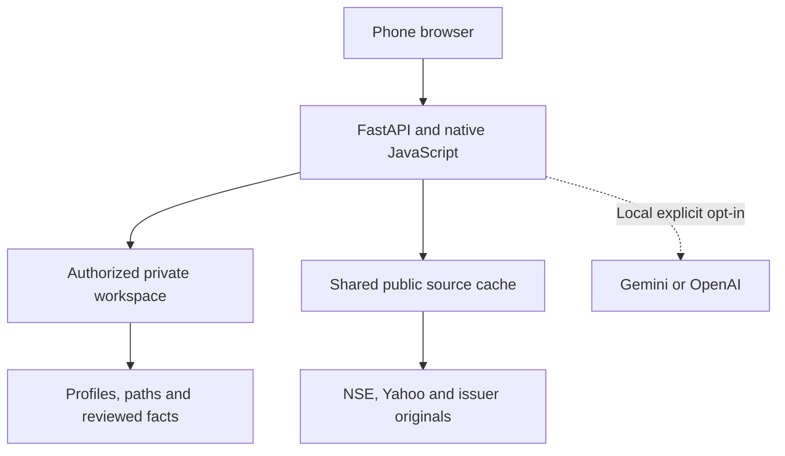

# FINN architecture and design decisions

FINN connects one investor journey: notice a relevant filing, inspect its primary evidence, and find a person with relevant experience. Rules and explicit evidence support that path across Push, Pull and Network. A model is an optional secondary reader.

## Runtime and ownership

One image serves static native-JavaScript modules and JSON routes. Python threads execute bounded acquisition/research jobs. SQLite stores shared public source data and separately owned private rows; raw public PDFs are retained by hash under a bounded data directory.

This intentionally replaces the initial React/TypeScript, PostgreSQL and cloud-object-store proposal. It keeps installation small and the main workflows free of model dependence. It does not provide PostgreSQL row policies, independent durable workers, a managed backup service, verified investor accounts or a persistent free-host disk.

| Module | Responsibility |
| --- | --- |
| `app.py` | HTTP capabilities, signed-session/CSRF enforcement, validation, bounded bodies, original-file routes and job entry points |
| `workspaces.py` | Session signatures, owner context, settings/holdings/alert state, migration, export/delete, expiry and public source quotas |
| `providers.py` | Public NSE JSON/RSS/CSV and completed Yahoo daily-bar normalization |
| `live.py`, `live_store.py` | Source/job state, metadata ranking/grouping, alerts, scheduled refresh and tracked-document queue |
| `discovery.py`, `documents.py` | Verified ticker link discovery, bounded downloads, lease ownership, hash/parser cache, transactional pages and retained originals |
| `research.py` | Exact topic passages, unaccepted candidate suggestions, reviewed fact validation, compatible comparisons and financial deltas |
| `network.py` | Owned profiles/dated employment/notes, explicit paths, relevance, identity corroboration and reconnect reasons |
| `desk.py`, `data/` | Dated historical benchmark and synthetic demo seeds |
| `analysis.py`, `llm.py` | Optional public-passage synthesis, provider transports, evidence validation and result/job cache |
| `smoke.py`, `acceptance.py` | Read-only deployment checks, disposable session isolation and optional cold-ticker acceptance |
| `assets/` | Brief, Research, People, private workbench/account, reusable source/person sheets and phone navigation |

## Public and private boundaries

Shared data include public prices, filings/revisions, document pages/hashes, acquisition status and public-only model results. A browser workspace owns holdings, alert preferences/history/read state, profiles, acquaintance links, private contact notes and reviewed facts. Human review decisions are private even though their source document is public.

API middleware establishes an owner from a valid signed cookie. Callers cannot pass another workspace ID to select rows. Every private lookup/mutation includes that owner; mutations additionally require CSRF and same-origin checks. Foreign-key cascades and tested delete paths remove owned rows. Anonymous APIs expose public evidence and fictional seeds, not another browser's rows.

Sessions are possession-based demo access. The cookie contains a random session identifier/expiry/HMAC; only its hash is stored server-side. Cookies are HttpOnly, SameSite=Lax and Secure on HTTPS. Signing secrets are server-side, generated and retained in a protected database unless explicitly configured. Session/workspace lifetime is 24 hours with no recovery mechanism.

Access immediately rejects expired/revoked cookies. Startup, API access and a 60-second janitor remove expired rows. Consent-expired real profiles also lose their notes/edges. Erasure revokes the current session and removes private data while retaining shared public sources. Export contains readable owned settings/holdings/profiles/edges/notes/facts, never cookies, CSRF tokens or signing/model keys; alert history is not exported. Only network profiles/edges currently support re-import.

SQLite uses foreign keys, secure-delete and restricted file permissions. These are useful prototype controls, not storage encryption, a verified identity system or a replacement for production database row policies. The server operator can access its database. An HTTP LAN demo is appropriate for synthetic data; use trusted HTTPS before sensitive real-profile use.

## Four source pipelines

| Input | Identity and processing | Reliability / limitation |
| --- | --- | --- |
| EOD market | NSE symbol mapped to Yahoo `.NS`; one completed-session bar; price/volume rules | Excludes an active daily candle; prior-20 baseline excludes current volume; suppresses invalid/insufficient/split-affected comparisons |
| Filings | Exchange attachment/event identity, issuer, IST timestamp, title/details and source links | Overlapping date-window fetches; RSS explicitly partial; exact duplicates group conservatively; attachment amendments retain metadata revisions |
| Fundamentals | Symbol-verified Screener link index → issuer-original PDFs → hash/parser-version pages | One annual report/up to four transcripts; unknown release dates labelled; scans without text/oversized/encrypted inputs fail explicitly; failed replacements preserve usable prior revisions |
| Network | Synthetic seed or attested local import; dated employment and education separate from acquaintance edges | Direct/two-hop path requires recorded links; no profile scraping, inferred acquaintance or namesake biography |

NSE symbols are the implemented company identifier. ISIN/alias history, symbol-renaming reconciliation, BSE-only instruments and a separate security master remain future work. Generic discovery verifies the requested ticker in the link index; it does not independently verify all seed symbols against a current official securities list.

A tracked ticker's relevant new/material filing revision queues document refresh. Each acquisition cycle processes at most one such job. Ownership tokens and renewed leases prevent a stale worker from replacing a current job; replacements are transactional. Same hash/parser version skips parsing. Retained raw PDFs are content-addressed, atomically written and bounded to 256 MiB locally/64 MiB publicly. Eviction removes a cached-file link, not source text or the issuer URL.

Public interactive acquisition has one document worker, document starts capped at five/workspace/hour and 20 globally/hour, and one live refresh globally/15 minutes. Private workspaces are capped at 100 and monitored source symbols at 100 across holdings. These are prototype resource bounds, not a comprehensive public abuse-control system.

## Evidence and comparisons

The source-first brief selects exact contiguous spans by business/outlook/cash/risk terms. It presents excerpts with document/page links and labels selection as partial. A missing term match is not proof that a company omitted disclosure.

Candidates are unaccepted drafts. Speaker heuristics distinguish an explicit analyst/question marker from management; ambiguous authority stays unidentified. Review suggestions only fill straightforward percentage metrics/ranges, explicit periods and bases. Nothing is auto-saved.

A reviewed fact records source revision, quote/page, publication date, speaker authority, metric, fiscal period, units, currency basis, consolidation scope and numeric value/range. Validation checks source ownership by ticker, exact page span and literal numbers; a person confirms the accounting interpretation. It does not prove that the selected figure semantically represents the chosen metric.

Comparison uses Decimal arithmetic after matching metric, period, units, scope and basis. Original/revised guidance remains separately visible. A missing actual is pending; incompatible/unknown metadata, chronology problems, changed revisions or conflicting latest outcomes withhold a verdict. An actual can be above, within or below a compatible range.

Financial records use the latest unambiguous reviewed actual for a matching basis/period. QoQ/YoY require exact adjacent/prior-year fiscal quarters; percentages produce pp deltas, while amount growth requires a positive base. There is no universal table extraction, accounting reconciliation or automatic four-line results card in Push.

As-of requests exclude later and undated shared evidence. Explicit private publication-date confirmations apply only to that person's reviewed facts. The historical INFY case filters its forecasts/outcome independently. Optional synthesis is disabled on dated views to avoid future context.

## People and identity

Profiles store dated roles separately from links and notes. Employer/topic relevance, recorded distance and recency drive recommendations. Existing school/employer overlap never creates an acquaintance edge. No path means no introduction.

Identity matching requires full name plus recorded employer, role and tenure at the event date. CEO/CFO/MD aliases normalize to the corresponding title. Multiple corroborated profiles remain ambiguous; future/unknown tenure remains unresolved. Explicit appointment metadata can nominate an incoming person for this check; unclear filing text is left unknown. This is corroboration against supplied records, not independent identity verification or automatic biography generation.

A private last-contact date can produce a reconnect reason after 90 days. Pull refers to the current research context; Push refers to an actual filing context. No email, message or contact request is sent by the application.

## Consent, retention and logs

Public demos reject real profile imports. Local real imports require an attested opt-in, explicit investment-research purpose, provenance and nonexpired consent date. Profile-ID merge supports correction; withdrawal deletes owned profile/links/notes. No external consent service is contacted and FINN cannot establish authenticity of an attestation. The UI/import schema does not solicit private phone numbers or email addresses.

Application HTTP access logs are disabled to avoid query-string names/notes. Provider failures are redacted and raw prompts/keys are not logged by FINN. Reverse-proxy/hosting logs and downloaded user exports are outside its retention controls.

The application creates no backups. The plan's proposed 30-day expiry for deleted data in future backups is therefore a production-policy requirement, not a claimed backup feature. Storage encryption, restricted managed access, restore/deletion drills, organization membership and recovery should precede real investor use.

## Optional models and agents

Local explicit opt-in supports Gemini/OpenAI through one structured-output workflow. It sends only up to 18 public passages/36,000 characters from at most five documents. Private names, notes, holdings and reviewed facts are excluded. Citation/page/numeric-literal checks establish provenance, not semantic entailment; interpretations are labelled and unsupported findings are withheld.

Caches separate provider/model/lens/document/prompt identities. Ownership renewal protects long calls; at most two generation jobs run. Tokens, latency and available estimates are recorded. No automatic retry or provider fallback is made. Metadata diagnostics are GET-only; live inference/cost has not been validated in this release build.

No free-running agent searches, plans external actions, contacts people or places trades. Scheduled ingestion is ordinary application code. Public deployments force models and the acquisition scheduler off even if their environment flags/keys are present.

## Deployment and verification

The Render Free Blueprint enables bounded interactive synthetic workspaces. Anonymous visitors start with a dated replay, and can open their own workspace to discover fresh evidence. A strict public read-only configuration also remains available. Free-host local storage is ephemeral; this is a demo-hosting tradeoff, not durable private hosting.

`FINN_TRUST_PROXY=1` trusts forwarded HTTPS only behind a known edge (the supplied Render configuration). Direct local mode uses 0. Validate the actual host's cookie/origin behavior after deployment.

Tests use real loopback HTTP routes and controlled external responses. They test two-browser isolation, expiry/withdrawal, cold-ticker indexing/review, source revisions, arithmetic, thresholds, model boundaries and failure recovery. Browser checks cover the new controls at 360/390/430 px. Docker/GitHub CI, actual deployment, live independent-ticker access, source reconciliation and second-person phone timing remain operator checks. See [PLAN_AUDIT.md](PLAN_AUDIT.md) and [RELEASE_CHECKLIST.md](RELEASE_CHECKLIST.md).
