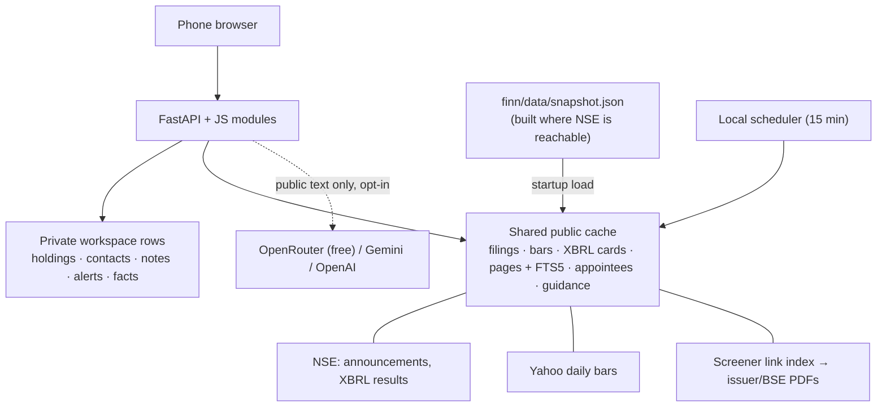

# FINN architecture

FINN is one FastAPI service with native JavaScript modules and SQLite, packaged as one Docker image. The design goal was the smallest system that does the real thing: real exchange data in, numbers computed in code, people and promises traced to the page they came from, and models used only where reading prose genuinely needs one.

## 1. Data pipelines

| Source | Fetch and refresh | Storage and identity | Linking |
| --- | --- | --- | --- |
| Filings | NSE `corporate-announcements` (per symbol for snapshots, date range for refreshes); RSS fallback marked partial; official CSV import | `live_filings` keyed by symbol + attachment URL; every metadata revision kept | Classified from NSE's subject and the filing text; management changes and results trigger enrichment |
| Results | NSE `integrated-filing-results` (from the March 2025 quarter) and the older `corporates-financial-results` listing; XBRL instances parsed directly | `results_cards`: latest card plus 10-quarter history; consolidated preferred; never mixes scopes | Attached to the results filing broadcast within −1…+3 days; history feeds promised-vs-delivered |
| Prices | Yahoo completed daily bars after the 16:15 IST buffer; a missing final close is taken from quote metadata only when stamped after that session | `daily_bars` | Price ±X% and volume >N× the prior-20-session mean, per workspace rules |
| Documents | Screener's public link index for the NSE symbol (verified on the page) → up to 2 annual reports and 8 transcripts, newest by call month; BSE PDF handlers accepted | Pages by SHA-256 revision and parser version; PDFium in a subprocess with a deadline; FTS5 index kept by triggers | Transcripts feed guidance extraction, cached per revision |
| People in filings | Regulation 30 attachments for management-change filings | `filing_people`: name, change, role, brief profile, employers (+ joining year), schools | A person named without a profile borrows the same issuer's earlier profile for that name |
| Network | Fictional seed; local JSON import with consent fields | Workspace-owned profiles with dated employment and schools; acquaintance edges with strength 1–3 | Matched to filing people by organisation (legal-suffix-insensitive, "X Group" covers X companies) and exact school |

**Snapshot.** NSE rejects many cloud IP ranges and free hosts lose their disk on restart. `python -m finn.snapshot build` runs where the sources are reachable and writes everything above for the portfolio (plus guidance for the research names) into one ~400 KB JSON file that ships with the image. The brief anchors its windows to the snapshot time until a live fetch is newer, so a reviewer sees real, dated records rather than an empty feed.

**Concurrency.** SQLite runs in WAL mode so polling readers never stall a document import's commit; long jobs hold renewable leases so a stale worker cannot overwrite a newer one.

## 2. What is computed, what is read by a model

| Task | Approach | Why |
| --- | --- | --- |
| Filing materiality | Rules over NSE subject + text | Deterministic, explainable, free |
| Revenue / EBITDA / PBT / PAT, QoQ / YoY, margins, tax rate | Code over XBRL | Exact figures; no extraction risk |
| Appointee name, role, career, schools | Rules over the Reg 30 text; optional cheap model refinement | Structured enough for rules; the model may only return strings present in the filing |
| Guidance statements | Cheap model over keyword-prefiltered passages (≤14 per transcript) + rules; union, de-duplicated | Prose needs reading; prefiltering keeps each call to ~20 k characters |
| Verdicts | Code | A model never decides whether a promise was met |
| Narrative synthesis (optional) | One stronger-model call over ≤18 public passages, citations verified, cached | Only where reasoning across passages adds value |

**Routing and cost.** Bulk extraction uses `FINN_<PROVIDER>_BULK_MODEL` (defaults to the main model); synthesis uses the main model. The default provider is OpenRouter's free router with zero-price caps, so the demo costs nothing. Every extraction is cached by document revision: a transcript is read once, ever. A failed or rate-limited call falls back to rules; there is no silent paid fallback.

**Verification.** Every model statement must quote its passage exactly, and every number must appear literally in that quote (so "16%" cannot become 0.16). Analyst questions are never guidance. Periods are explicit, or inferred from the call date and labelled as inferred. Model and rule outputs carry their method in the UI.

**Agents.** None act autonomously. The scheduler and enrichment are ordinary code with bounded work per cycle; nothing contacts people or places orders.

## 3. Privacy, security and consent

- **Ownership.** A signed, opaque, HttpOnly cookie identifies a workspace (only its hash is stored). Holdings, alert rules and history, contacts, edges, notes and reviewed facts are workspace-owned; queries are always filtered by the server-chosen owner; mutations require CSRF plus same-origin. Workspaces expire after 24 hours and can be exported or erased at any time; foreign keys cascade the deletion.
- **What reaches a model.** Public filing and transcript text only. Holdings, contacts, notes and facts are never sent.
- **Personal data stored.** For contacts: name, roles with dates, schools, topics, an optional private note and last-contact date. For people in filings: what the company itself disclosed. No phone numbers or emails are requested.
- **Consent.** The public demo accepts fictional profiles only. Local imports of real profiles require an attested opt-in, an investment-research purpose, provenance and an expiry; expired consent removes the profile with its links and notes. FINN validates these records but cannot verify an attestation.
- **Storage.** SQLite with secure-delete; the database and its WAL side files are mode 0600. Access logs are off so names in query strings are not logged.
- **Production next steps.** Real accounts (SSO) and organisation membership; Postgres with row-level security; encryption at rest with managed keys; backups with a ≤30-day deletion horizon; a consent ledger for imported profiles; a data-processing agreement with any model provider.

## 4. Cloud

| Piece | Where | Why |
| --- | --- | --- |
| Web app | Render Free (Docker) | Zero cost, HTTPS at the edge, phone-reachable |
| Keep-warm | GitHub Actions cron hitting `/health` every 10 min | Avoids 20–50 s cold starts within the free hours |
| Snapshot build | A machine with an Indian/residential IP (today: the developer's laptop) | NSE blocks many cloud ranges |
| Models | OpenRouter free router by default; Gemini/OpenAI optional | Free tier for the demo; provider-agnostic adapter |
| CI | GitHub Actions builds the real container and runs the suite, smoke and session checks | The deployed artefact is the tested artefact |

The production shape is the same split with durable pieces: a scheduled ingestion worker in an Indian region, Postgres + object storage for originals, and the web tier stateless.

## 5. Known limits

Scanned PDFs need OCR (not implemented). Some issuer sites serve incomplete TLS chains, so their PDFs fail verification and are reported, not bypassed. Revenue guidance given in constant currency is shown but not scored against INR filings. Filed EBIT can differ from a company's "adjusted" EBIT. The relationship map (competitors, suppliers, customers) is a small curated file.
