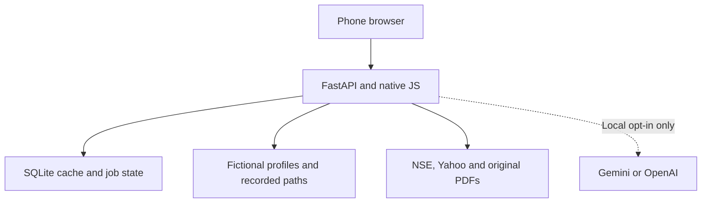

# FINN: architecture, privacy and tradeoffs

FINN connects one investor journey: notice a relevant filing, inspect its evidence, then find a person with relevant experience. The prototype concentrates on that path across Push, Pull and Network. Core behavior uses public-source acquisition, explicit rules, keyword retrieval, Decimal arithmetic and recorded relationships. Models are an optional secondary reader.

## What runs where

One Docker image serves the UI and JSON routes. Static files need no frontend build. A local named volume retains SQLite state; background threads own bounded ingestion/research jobs. The public deployment uses the same image on Render Free, with a read-only HTTP boundary, no acquisition scheduler and models forced off. Its dated demo data ships as JSON rather than depending on free-host storage. No paid database, bucket or hosted scheduler is required.

The initial design proposed React/TypeScript, Postgres, object storage, signed sessions and private workspaces. The implementation uses native JavaScript and SQLite to reduce installation/deployment work and preserve zero model dependence for the main flow. It is a single synthetic workspace, not the original plan's multi-tenant system. The following privacy and deployment boundaries are explicit rather than claimed as finished infrastructure.

## Four data pipelines

| Input | Acquisition and identity | Storage, refresh and use |
| --- | --- | --- |
| Prices/volume | Yahoo daily bars mapped from portfolio NSE symbols; completed-session checks and corporate-action suppression | One row per ticker/session; previous close and prior 20-session volume baseline; deterministic alerts |
| Filings | NSE date-filtered announcements with RSS fallback; operator CSV import is available; normalized source identity | Idempotent SQLite records, coverage/last-success state, IST windows and metadata priority rules |
| Fundamentals | Screener identifies issuer-original annual-report/transcript PDF links; downloads validate public HTTPS targets | SHA-256 revisions, transactional page index, source/page evidence, generic ticker keyword search; scans without text fail explicitly |
| Network | Twelve explicitly fictional profiles with employer, tenure, topics and acquaintance edges | Source-controlled synthetic seed; deterministic employer/topic matching and direct/two-hop paths; no professional-profile scraping |

Live ingestion runs on the local server at the configured interval; failures retain the last usable records and expose coverage gaps. A notice and published results can share a category but receive different materiality. These rules do not claim to understand the entire filing.

The guidance example preserves four dated FY25 constant-currency forecasts and a 4.2% outcome. Decimal arithmetic compares them on one matching metric/period/basis. It is a curated primary-source case, not a generic automatic fact-extraction engine. New tickers support original-document discovery, indexing and search; a missing structured comparison stays missing. Screener tables, broker notes, news and model memory are excluded from Pull evidence.

## Network identity and linking

A common NSE ticker links company records, filings, reports and seeded employment. Exact company/sector relevance explains a recommendation. An introduction requires recorded acquaintance edges from the investor, with a maximum of two hops. Shared employment is relevance evidence, not proof that two people know each other. The prototype does not resolve incoming executives from names in live filings or infer identities from namesakes.

The same person card appears inside the brief, research and People queries. An unseen employer without a recorded overlap produces no invented contact. Production matching would store dated employment, source provenance and user-confirmed identities separately, requiring corroborating employer/role/tenure before linking a filing name.

## Security and personal data

| Current boundary | Implementation and limitation |
| --- | --- |
| Public presentation | `FINN_PUBLIC_DEMO=1` rejects all non-read HTTP methods before route work, disables the startup refresher and overrides the AI-enable flag. It is anonymous and exposes the supplied fictional workspace. This is not investor authentication. |
| Local workspace | Full ingestion and alert controls; same-origin mutation checks. These checks do not replace authentication. Keep it local and use only public issuer evidence and synthetic contacts. |
| Credentials | Server environment only; `.env` excluded from Git and Docker context. No model keys in catalog/status responses. Public deployment needs no model credentials. |
| Model boundary | Only bounded public passages and coverage metadata enter a generation request. Private portfolio/contact data are not supplied to the model. No automatic fallback or retry. |
| Retention | Local SQLite data remain until the operator removes them; free-host state is ephemeral. No automatic 24-hour workspace deletion, user erasure API or backup-expiry enforcement is implemented. |
| Logs | Provider error output is allowlisted/redacted and raw model requests are not logged. Ordinary HTTP access logs may contain URL query strings; do not introduce real personal queries into this demo. |

For real contacts, the next architecture needs authenticated workspace membership, authorization on every private lookup/update, Postgres row policies under a non-owner application role, encrypted managed storage and restricted logs. Obtain consent for named fields/purposes; offer correction, withdrawal and deletion. The initial plan's 24-hour demo expiry and proposed 30-day deleted-data backup expiry require actual deletion jobs and policy verification before they can be promised. The public demo deliberately stores no real network profiles.

## Optional model workflow

`FINN_ENABLE_LLM=1` is effective only outside public mode. Gemini and OpenAI have explicit transports and use one shared output schema. `auto` prefers Gemini if both keys exist; a failure never switches provider. Neither model is required for Push, source search, historical comparison or People matching.

The fixed workflow selects at most 18 passages/36,000 characters from at most five originals, requests one structured response, then checks exact quotes, passage/page references and numerical literals. Unsupported findings are withheld. This proves traceability, not semantic entailment; model interpretations remain labelled. No free-running agent plans, searches the web, contacts people or takes independent actions. Scheduled acquisition is ordinary application code.

Completed results are keyed by provider/model/lens/document/prompt identity; repeated views reuse the result. Jobs have ownership/lease renewal and a concurrency cap. Tokens, latency and available cost estimates are recorded; Google free-tier eligibility and provider billing remain external. Tests use controlled responses and do not prove live inference availability.

## What is verified and what remains

Python unit/integration tests exercise the actual HTTP routes, source adapters through fixtures, source replacement, thresholds, network paths, optional-model transports, cache/ownership and the public boundary. `python -m finn.smoke` reads a running release without starting refresh, discovery or generation. The CI workflow also builds/runs Docker, but its actual GitHub execution requires a push.

The public URL, clean-clone Docker run, current upstream access and a tester-selected unseen ticker still need operator verification. Mobile layouts were checked with browser interactions; they do not replace a second person's phone usability run. See [RELEASE_CHECKLIST.md](RELEASE_CHECKLIST.md).
